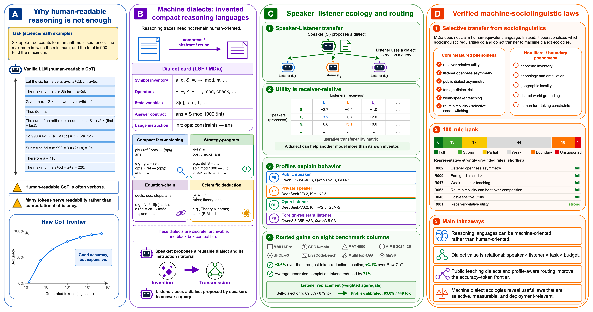

# Machine Dialectology (MDia)

MDia studies a practical question: **which parts of a reasoning procedure can one language model express in a form that another can use?** The framework represents a procedure as a reusable *dialect card*: a vocabulary, a grammar, a set of operations and an answer contract. A card records who produced it, which earlier cards it inherits from, and how it performs with each tested receiver. A model can therefore use a compact symbolic procedure where it helps and retain a strong English or direct solver where that works better.

[Benchmark results](#benchmark-results-and-reproduction) · [Quickstart](#quickstart) · [Pipeline](#canonical-pipeline) · [Documentation](#documentation) · [Citation](#citation)

[](assets/readme/pipeline-Jul15-v0.png)

## Benchmark results and reproduction

The [benchmark collection](artifacts/research/20261103/README.md) covers **11 benchmarks and four native model families**: DeepSeek, GLM, Qwen and Kimi. Each comparison identifies the procedure, its reference, the shared cohort and the native tokens used to serve both. The studies use development-exposed panels. Their differences describe the specified models and comparators.

| Task and receiver | Comparison | Correct, procedure / reference | Gain | Change in recorded total tokens |
|---|---|---:|---:|---:|
| GPQA · DeepSeek-V4-Pro | Typed bounds / paired English | 182 / 168 of 256 | +5.47 pp | +0.46% |
| MultiHop-RAG · DeepSeek-V4-Pro | Selective evidence / paired English | 206 / 190 of 256 | +6.25 pp | +2.69% |
| MultiHop-RAG · Qwen3.6-35B-A3B | Typed query / paired English | 214 / 174 of 256 | +15.63 pp | −0.82% |
| CRUXEval · GLM-5.2 | Selective literal integrity / Raw CoT | 241 / 229 of 256 | +4.69 pp | +16.41% |

The reference matters. Against stronger English procedures on GPQA and MultiHop, DeepSeek-V4-Pro scored **182 vs 177** and **206 vs 205**, respectively, using **27.47%** and **10.59%** fewer recorded total tokens. Both paired accuracy intervals include zero. On Qwen MultiHop, TALE and schema each scored 221/256. The [16 comparisons](artifacts/research/20261103/COMPARISONS.md) give the intervals, subgroup sizes and control scores for all 11 benchmarks.

**A higher score can come from a different answer or from a different way of delivering the same answer.** On MultiHop, both procedures produced extractable answers on all 256 questions: 19 favored selective evidence and three favored English on DeepSeek; the corresponding counts on Qwen were 48 and eight. On BFCL, 15 of the 21 Kimi-Code tasks solved only by the GEPA procedure contained the same proposed tool calls as the English control. What differed was the format in which the calls reached the evaluator. Both BFCL procedures were written in English. The [paired analyses](artifacts/research/20261103/FINDINGS.md) distinguish these two sources of improvement and show how the choice of a fixed baseline changes the apparent difference between receivers.

Reproduce the numerical analysis offline with Python 3.10 or later:

```sh
python3 scripts/reproduce_mdia_evidence_20261103.py --check
python3 scripts/reproduce_mdia_evidence_20261103.py --output runs/mdia-20261103
```

The first command checks the published files; the second writes the comparison table, findings, and separate accuracy and serving CSVs to a new or empty directory. The [October accuracy and generation-token study](MDIA_EVIDENCE_README.md) provides the earlier paired observations, frontier plots and [downloadable reproduction package](releases/mdia-results-20261005.zip). On GPQA, the earlier GLM comparison recorded 194 vs 180 correct with 16.45% fewer generated tokens; on MultiHop-RAG, DeepSeek-V4-Flash recorded 172 vs 167 against Sketch-of-Thought with 60.29% fewer generated tokens. These savings measure generation; the November table measures input plus generation.

## Quickstart

Run the deterministic example with Python 3.10 or later:

```sh
python3 -m venv .venv
source .venv/bin/activate
python -m pip install -e .
mdia pipeline --config configs/toy_mdia.yaml
```

The [toy task set](examples/toy/) and replay provider exercise the entire lifecycle without credentials. The run writes a manifest, card generations, transfer profiles, a frozen bank, route decisions, predictions and an accounting report. A [complete example](artifacts/example/README.md) shows the output layout.

## Canonical pipeline

A speaker specifies a procedure; a listener uses it to solve a task. The stored card binds the symbols and operators to an explicit input/output contract. Two cards with similar vocabulary can lead to different predictions, and the same card can behave differently with another listener. MDia stores those measurements separately from the card text.

| Stage | What the system records |
|---|---|
| Collect and create | Direct traces on the induction partition and the first generation of cards |
| Evolve | Each generation's source cards, edits, borrowing and validation evidence |
| Profile and select | Receiver-specific accuracy, tokens and parse outcomes; the frozen bank |
| Run | The selected card or fallback, the model response, the evaluated answer and token accounting |
| Validate and report | Evidence-linked rule evaluations, routing decisions and held-out performance |

The [pipeline guide](docs/pipeline.md) defines the separate induction, evolution-validation, router-validation and test partitions. The [card and provider interfaces](docs/extending.md) support additional datasets and receivers. **CLSR** is the homogeneous-agent configuration of the same framework; see [the CLSR preset](configs/clsr.yaml).

## Routing semantics

A dialect router selects concrete cards by their frozen identifiers. A controller router selects an answer procedure, such as producing a schema or performing a verification step. Route plans distinguish using a single card, aggregating candidates, composing stages and falling back to a fixed solver. The resulting record makes it possible to compare selection against the same solver used on its own. The [architecture guide](docs/architecture.md) defines these interfaces.

## Documentation

| Resource | Contents |
|---|---|
| [Benchmark evidence and methods](artifacts/research/20261103/README.md) | Paired comparisons, exposure, group structure, serving and construction accounting |
| [October numerical release](docs/evidence-release-20261005.md) | Accuracy and generation-token frontiers, original settings and reproduction instructions |
| [Reproduction and data policy](docs/reproduction.md) | Offline verification, adapter experiments and historical inference protocols |
| [Paper-to-code map](docs/paper-to-code.md) | Manuscript concepts and their supported implementation |
| [Rule validation](docs/rules.md) | Evidence streams, statistical tests and interpretation |
| [Legacy implementations](legacy/README.md) | Earlier CLSR and MDia workspaces from the original `pzqpzq/LSF_MDia` repository |

## Citation

Use [CITATION.cff](CITATION.cff) to cite the software. The [MDia manuscript](papers/MDia_Jul17.pdf) presents the framework. For CLSR, cite Zhengqi Pei, Qingming Huang and Shuhui Wang, [*When LLMs Develop Languages: Symbolic Communication for Efficient Multi-Agent Reasoning*](https://arxiv.org/abs/2606.29354), ICML 2026.

Code is released under the [MIT License](LICENSE). Benchmark data and model weights retain their original licenses. For reproducibility questions, include the configuration, model revision, evaluator and smallest redistributable example. Academic correspondence: `peizhengqi22@mails.ucas.ac.cn`; industry collaborations: `peizhengqi@chipflow.net`.
