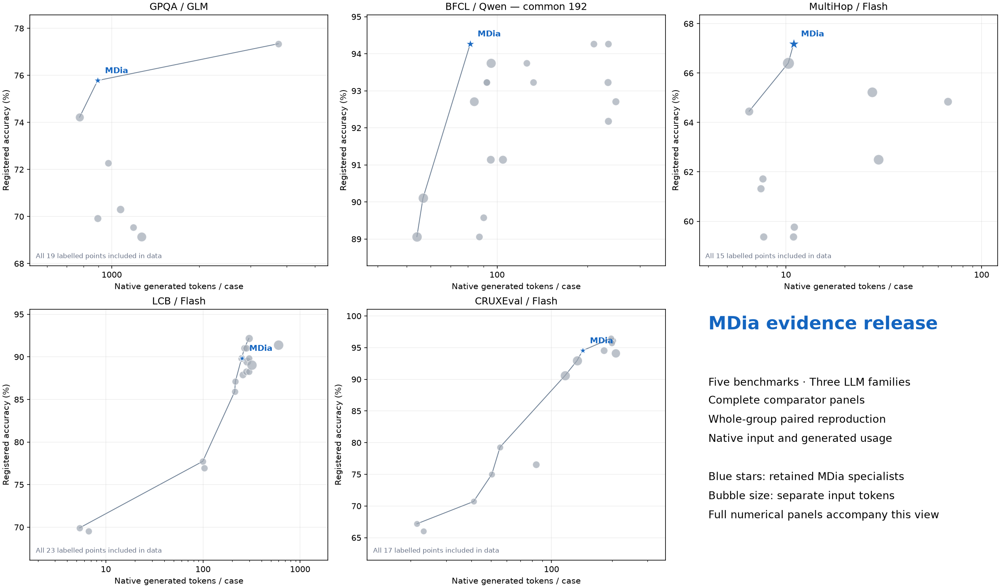

<div align="center">

<h1>Machine Dialectology (MDia)</h1>

<p>
(Note that this repository is migrated from the original pzqpzq/LSF_MDia, whose account is suspended without reason.)
</p>

<p><strong>Reusable symbolic protocols for heterogeneous language-model societies.</strong></p>

<p>
MDia studies how LLMs invent reasoning dialects, teach through them, resist them, and code-switch across tasks.
</p>

<p>
  <a href="https://github.com/pzqpzq/LSF_MDia/actions/workflows/ci.yml"></a>
  <a href="https://www.python.org/"></a>
  
  <a href="LICENSE"></a>
</p>

<p>
  
  
  
</p>

<p>
  <a href="#overview">Overview</a> ·
  <a href="#quickstart">Quickstart</a> ·
  <a href="#canonical-pipeline">Pipeline</a> ·
  <a href="#routing-semantics">Routing</a> ·
  <a href="#benchmark-results-and-reproduction">Results</a> ·
  <a href="#reproducibility-by-construction">Reproducibility</a> ·
  <a href="#documentation">Documentation</a> ·
  <a href="#citation">Citation</a>
</p>

</div>

<p align="center">
  <a href="assets/readme/pipeline-Jul15-v0.png">
    
  </a>
</p>

<p align="center">
  <sub><strong>Machine Dialectology: from verbose reasoning traces to a measurable ecology of machine dialects.</strong> Click the figure to inspect the full-resolution manuscript asset.</sub>
</p>

---

## Overview

Large language models increasingly operate as heterogeneous systems of solvers, routers, critics, and tool users. Yet their intermediate reasoning is still usually expressed as human-facing prose. Natural language is readable and flexible, but it can spend generated tokens on discourse, pedagogy, and surface conventions that a machine listener may not need. Simply forcing shorter answers is not enough: aggressive compression can remove variables, evidence links, parse commitments, verification state, or output contracts that the listener *does* need.

**Machine Dialectology (MDia)** treats an intermediate trace as a message produced by one machine component and interpreted by another. Speaker models create persistent **Language Symbolism Frameworks (LSFs)**—compact dialect cards with symbols, grammar, reusable operators, validity rules, answer contracts, provenance, and empirical transfer profiles. Listener models execute those dialects, and MDia routes them under explicit accuracy, token, parseability, and reliability constraints.

> **Central thesis**
>
> A machine dialect is not intrinsically strong or weak. Its value is relational:
>
> **dialect utility = f(speaker, listener, task, route, budget).**

> [!IMPORTANT]
> Use **MDia** as the framework for new experiments and applications. **CLSR** is its homogeneous-agent, concrete-LSF-routing special case configured through [`configs/clsr.yaml`](configs/clsr.yaml). The supported implementation lives under [`src/mdia/`](src/mdia/); historical research workspaces remain under [`legacy/`](legacy/README.md) for provenance and are not the public API.

### At a glance

| Dimension | MDia |
|---|---|
| **Scientific object** | A reusable machine dialect represented as a persistent LSF card |
| **Unit of analysis** | A speaker–listener–dialect–task event |
| **Core lifecycle** | Collect → create → evolve → profile → select → route → validate → report |
| **Inference plans** | `single`, `aggregate`, `compose`, and guarded `abstain/raw-fallback` |
| **Compatibility** | Discrete, archivable, auditable, and compatible with black-box LLM APIs |
| **Selection principle** | Freeze dialects and route policies from validation evidence before held-out execution |
| **Research scope** | Accuracy–token frontiers, cross-model transfer, listener openness/resistance, publicness, teaching advantage, code-switching, and negative-transfer guards |

## Why machine dialectology?

| Conventional view | MDia view |
|---|---|
| A reasoning trace is primarily an explanation for people. | A reasoning trace is also a machine-to-machine protocol. |
| Shorter traces are automatically better. | Compression is useful only when the right state survives for a particular listener. |
| A prompt or language has one global quality score. | Dialect utility is receiver-relative and task-conditioned. |
| A stronger solver should also be a stronger teacher. | Weak or specialized speakers can produce highly adoptable public dialects. |
| More agents mainly imply voting, debate, or longer deliberation. | Agents can invent, inherit, borrow, teach, resist, and code-switch between dialects. |
| Hidden-state access may be required for compact communication. | MDia uses discrete protocols that can be stored, hashed, compared, and routed across black-box models. |

This perspective separates **brevity** from **communicative adequacy**. The objective is not to minimize tokens in isolation; it is to preserve the task-relevant state that a specific listener can reliably interpret under a budget.

## Benchmark results and reproduction

The October 2026 release provides measured MDia receiver profiles across **five benchmarks and three LLM families: GLM, Qwen and DeepSeek**. Reusable dialects encode task-relevant obligations, function-call procedures, evidence links, compact code state and Python execution state.

| Benchmark / receiver | Cases | Comparator | Correct: MDia / comparator | Generated tokens per case: MDia / comparator | Generated-token saving |
|---|---:|---|---:|---:|---:|
| GPQA / GLM-5.3 | 256 | Paired English formulation | **194 / 180** | 894.398 / 1,070.523 | **16.45%** |
| BFCL / Qwen3.6-35B-A3B | 192 | English, 8192-token cap | **181 / 177** | 81.380 / 234.583 | **65.31%** |
| MultiHop-RAG / DeepSeek-V4-Flash | 256 | Sketch-of-Thought, 8192-token cap | **172 / 167** | 10.953 / 27.586 | **60.29%** |
| LiveCodeBench / DeepSeek-V4-Flash | 256 cases / 104 problem groups | Raw CoT, 8192-token cap | **230 / 230** | 251.520 / 296.566 | **15.19%** |
| CRUXEval / DeepSeek-V4-Flash | 256 | Paired English formulation | **242 / 242** | 142.695 / 181.887 | **21.55%** |

Savings refer to native **generated tokens**, including native reasoning once. Native input usage is reported separately in the complete tables, and TALE accounting includes both estimator and solver stages. Correct counts describe the recorded cohort. The BFCL row uses the source Qwen parent profile and a new common-cohort English comparison.

In the Qwen BFCL common-192 panel, the MDia parent improves the observed accuracy/generated-token point over **11 of 13 baseline points**, spanning six baseline families. All seven registered baseline families remain in the full panel. The English comparison's generated-token saving has an ordinary whole-group bootstrap interval of **60.63–69.41%**.



### Reproduce the released tables and figures

Clone this repository, use **Python 3.11+** (tested with Python 3.12.14), and run:

```bash
python3 -m venv .venv-evidence
source .venv-evidence/bin/activate
python -m pip install -r requirements-evidence.lock.txt
python scripts/verify_mdia_release.py
python scripts/reproduce_mdia_release.py --output runs/mdia-results-20261005
```

Choose a fresh output directory. The command verifies the file manifest, recomputes aggregates, whole-group paired intervals and accuracy/generated/input frontiers, checks the saved numerical references, and exports the tables and PNG/SVG figure. It runs offline without API credentials. `VALIDATION.json` records the checks and runtime versions.

The package contains **16,576 case-policy observation rows**, the complete **55-point Flash 256-case block**, all **36 BFCL common-192 points / 34 contrasts**, all **36 CRUXEval common-192 points / 52 contrasts**, and **303 baseline summary rows**. Original cohort and logical alias identities remain available throughout the numerical records.

- [Results overview and instructions](MDIA_EVIDENCE_README.md)
- [Full BFCL common-192 table](artifacts/research/20261005/results/BFCL192_ALL_POINTS.csv)
- [Full Flash 256-case table](artifacts/research/20261005/results/FLASH256_ALL_POINTS.csv)
- [Full CRUXEval common-192 table](artifacts/research/20261005/results/CRUX192_ALL_POINTS.csv)
- [Paired settings and separate input accounting](artifacts/research/20261005/results/POSITIVE_RESULTS.md)
- [Reproduction protocol, seeds and source mapping](docs/evidence-release-20261005.md)
- [Download the versioned package](https://github.com/pzqpzq/LSF_MDia/raw/refs/tags/mdia-results-20261005/releases/mdia-results-20261005.zip)

These commands reproduce the numerical analyses and presentation from the released scalar records. For new model inference, acquire the benchmark inputs from their original sources and use the dataset/provider interfaces in [Extending MDia](docs/extending.md).

## Quickstart

The deterministic toy pipeline exercises the complete lifecycle with redistributable fixtures. It requires **Python 3.10+**, no API key, and no model download.

```bash
python -m venv .venv
source .venv/bin/activate
python -m pip install -e .

mdia pipeline --config configs/toy_mdia.yaml
```

The command creates a versioned run directory containing immutable split manifests, direct traces, dialect generations, transfer profiles, a frozen dialect bank, route plans, predictions, token accounting, rule results, and a reproducibility report. Re-running with the same configuration and seed selects the same cards and routes.

```bash
mdia --help
mdia pipeline --help
```

<details>
<summary><strong>Expected artifact groups</strong></summary>

```text
runs/<run_id>/
  manifest.json
  report.md
  splits/{induction,evolution_validation,router_validation,test}.json
  direct_traces.jsonl
  dialects/generation-*.json
  profiles/{evolution_validation,router_validation}.jsonl
  selection/frozen_dialect_bank.json
  execution/{route_plans,predictions,evaluations}.jsonl
  execution/token_accounting.json
  rules/{registry,results}.json
```

Every value in the report is designed to resolve back to a run artifact, evaluator version, count, and checksum.

</details>

## Experiment with MDia

Use the canonical MDia framework to create and evolve dialect cards, profile their transfer across listeners, and compare budgeted routes on your own tasks. Start with the offline lifecycle below, then add datasets and providers through the [extension interfaces](docs/extending.md). The released [native policy identities](artifacts/research/20261005/protocols/native_policies.json) and [serving-specification examples](artifacts/research/20261005/protocols/serving_spec_examples.json) illustrate reusable task contracts and receiver profiles.

CLSR is MDia's homogeneous-agent special case, available through [configs/clsr.yaml](configs/clsr.yaml). Both use the same supported implementation under [src/mdia/](src/mdia/). MDia is the general entry point for experimenting with heterogeneous speakers, listeners, dialects and deployment policies.

## The scientific object: a dialect card

A dialect card implements the manuscript contract

<div align="center">

**D = (V, G, O, R, ρ)**

</div>

| Field | Meaning |
|---|---|
| **V — symbol inventory** | Compact names, tags, operators, and state markers |
| **G — grammar / schema** | The compositional form and parseable output structure |
| **O — reasoning operators** | Reusable transformations, checks, decompositions, and verification actions |
| **R — rules** | Validity, usage, avoidance, stopping, and fallback constraints |
| **ρ — empirical profile** | Validation utility, token statistics, failure modes, task affinity, and listener compatibility |

Cards also carry stable IDs, generation and parent links, creator/speaker provenance, task tags, I/O contracts, fallbacks, and a digest of the complete specification. This makes a dialect a persistent research artifact—not a one-off shortened answer or an unversioned prompt string.

## Canonical pipeline

The public CLI separates eight stages that older research scripts mixed together.

| Stage | Command | What is frozen or produced |
|---:|---|---|
| **1. Collect** | `mdia collect --config configs/toy_mdia.yaml` | Gold-free direct traces with model revision, seed, parsed output, score, tokens, latency, and cost |
| **2. Create** | `mdia create --config configs/toy_mdia.yaml` | Generation-0 cards induced from correct, concise, and optionally speaker-diverse traces |
| **3. Evolve** | `mdia evolve --config configs/toy_mdia.yaml` | Atomic generation checkpoints with inheritance, borrowing, evidence, hashes, and validation-saturation stopping |
| **4. Profile** | `mdia profile --config configs/toy_mdia.yaml` | Speaker–listener transfer records, confidence intervals, parse risk, cost, and task-conditioned utility |
| **5. Select** | `mdia select --config configs/toy_mdia.yaml` | A validation-frozen, Pareto-filtered, diversity-aware dialect-bank manifest |
| **6. Run** | `mdia run --config configs/toy_mdia.yaml` | Budgeted route plans, predictions, evaluations, and complete token accounting |
| **7. Validate rules** | `mdia validate-rules --config configs/toy_mdia.yaml` | Evidence-linked `RuleResult` records; insufficient evidence becomes `not_evaluated` |
| **8. Report** | `mdia report --config configs/toy_mdia.yaml` | A provenance-linked separation of held-out performance, route validation, and mechanism analysis |

The implementation preserves four immutable partitions:

| Partition | Permitted use |
|---|---|
| `induction` | Collect direct traces and create generation 0 |
| `evolution_validation` | Evaluate/update generations and decide saturation |
| `router_validation` | Build profiles, compare route policies, and freeze route settings |
| `test` | Execute the frozen bank and policy; never modify cards, profiles, or routes |

## Routing semantics

### What does the router route?

| Interface | It selects | Output | Role |
|---|---|---|---|
| `DialectRouter` | Concrete, frozen, evolved LSF cards | Stable dialect IDs and specification digests | Primary MDia and CLSR routing |
| `ControllerRouter` | A metadata-conditioned answer/controller family, such as schema-first or verifier-rich | A controller ID and answer contract | Optional policy layer for format-sensitive tasks |

The distinction is deliberate. A controller choice is not reported as a concrete-LSF route. A canonical run may record both, but the two decisions remain separate in artifacts and evaluation.

### Supported plans

| Plan | Semantics | Typical use |
|---|---|---|
| `single` | Execute one selected dialect card | Low-cost default when validation evidence is decisive |
| `aggregate` | Execute several cards independently, then combine by named majority, validation-weighted, score-based, or judge aggregation | Ambiguous items where controlled redundancy is useful |
| `compose` | Execute an ordered planner/solver/verifier-style sequence with bounded rounds | Hard tasks requiring staged symbolic state and verification |
| `abstain/raw-fallback` | Avoid a predicted dialect mismatch and use the configured raw-answer policy | Resistant listeners, insufficient support, or foreign-dialect risk |

Before generation, routing may use the query, observable task metadata, listener profiles, frozen validation statistics, and the token budget. It may not use gold labels, held-out outcomes, or feedback from a candidate answer.

## Manuscript research snapshot

The July 30 MDia manuscript source reports the following aggregate picture across **eight benchmark columns**: MMLU-Pro, GPQA-main, MATH500, AIME 2024–25, BFCL-v3, LiveCodeBench-output, MultiHopRAG, and MuSR.

| Result | Manuscript-reported value |
|---|---:|
| Macro-accuracy gain over the strongest matched token-reduction baseline | **+3.6 points** |
| Macro-accuracy gain over Raw CoT | **+3.1 points** |
| Mean reduction in generated completion tokens | **71%** |
| Audited machine-sociolinguistic rules | **100** |
| Rules with full or strong support | **19** (`6` full + `13` strong) |

> [!NOTE]
> These are **paper-level findings**, not automatic guarantees from installing the package. The offline fixture verifies schemas, lifecycle logic, routing, provenance, and deterministic execution. Reproducing a named manuscript table requires the exact model revisions, task manifests, evaluators, seeds, provider settings, and release artifacts described by the paper protocol.

### Representative regularities

| Regularity | Operational interpretation |
|---|---|
| **Receiver-relative utility** | The same dialect can help one listener, constrain another, and fail for a third. |
| **Listener-openness asymmetry** | Models differ systematically in how much they benefit from foreign dialects. |
| **Public-dialect asymmetry** | Some speaker dialects transfer broadly; others remain effective mainly as private self-talk. |
| **Weak-speaker teaching** | A weaker solver can still produce a highly adoptable teaching dialect. |
| **Foreign-dialect risk** | Imported protocols require validation support and explicit negative-transfer guards. |
| **Route simplicity** | A single well-matched dialect can outperform unnecessary over-composition. |
| **Cost-sensitive utility** | A route must be evaluated jointly on correctness, generated tokens, parse risk, latency, and budget. |

The rule bank is deliberately conservative. Supported labels are evidence statements for the audited archive, not claims of universal laws or human-equivalent language emergence. Weak, boundary, and unsupported analogies are retained to constrain overclaiming.

## Reproducibility by construction

MDia is organized as an auditable research system rather than a directory of loosely coupled scripts.

| Guarantee | Implementation |
|---|---|
| **Leakage control** | Creation, evolution, routing validation, and testing use separate immutable partitions. |
| **Validation-frozen decisions** | Card selection and route settings are fixed before held-out predictions are scored. |
| **Stable identity** | Items and dialect cards carry content-derived IDs, hashes, provenance, and specification digests. |
| **Explicit accounting** | Every dialect-conditioned completion and generated aggregation/judge output is counted; prompt tokens remain available for cache-aware analysis. |
| **Evidence-aware rules** | Missing fields or insufficient support yield `not_evaluated`, never a fabricated positive result. |
| **Deterministic smoke test** | The toy provider and fixtures exercise the full lifecycle without external credentials. |
| **Quality gates** | CI covers Python 3.10–3.12, Ruff, formatting, mypy, pytest, Markdown link integrity, release hygiene, and secret scanning. |

### Reproduction levels

| Tier | Requires | Purpose |
|---|---|---|
| **Offline fixture** | This repository only | Verify schemas, lifecycle, routing, rule validation, and deterministic provenance |
| **Adapter run** | A compatible dataset plus provider | Exercise MDia on a new model/task without claiming paper reproduction |
| **Paper protocol** | Exact manifests, model revisions, evaluators, seeds, and release artifacts | Reproduce a named manuscript result or analysis |

Only redistributable fixtures and compact example artifacts should be committed. Restricted benchmark text, private prompts, credentials, provider ledgers, and remote paths do not belong in Git. See [Reproduction and data policy](docs/reproduction.md) before interpreting or publishing results.

## Repository map

```text
src/mdia/          canonical schemas, lifecycle, routing, evaluation, and rules
configs/           offline, CLSR, and paper-oriented presets
examples/toy/      redistributable deterministic fixture
artifacts/example/ committed complete offline example output
artifacts/research/ benchmark scalar records, reference tables and figures
releases/          versioned benchmark reproduction package
docs/              architecture, pipeline, reproduction, extension, and rules
papers/            manuscript snapshot included with the repository
legacy/            archived v0/v1/v2 research workspaces; noncanonical
tests/             unit, leakage, integration, and offline end-to-end checks
```

<details>
<summary><strong>Legacy workspace map</strong></summary>

| Historical name | Archived location | What it contains |
|---|---|---|
| `LSF-v0-draft` | [`legacy/clsr-v0-workspace/`](legacy/clsr-v0-workspace/STATUS.md) | Early CLSR scripts and the recovered meta-LSF prompt bank |
| `LSF-v1` | [`legacy/mdia-v1-workspace/`](legacy/mdia-v1-workspace/STATUS.md) | Heterogeneous LSF evolution, concrete-card transfer, and experimental routing artifacts |
| `LSF-v2` | [`legacy/mdia-strategy-router-v2/`](legacy/mdia-strategy-router-v2/STATUS.md) | Metadata-conditioned handcrafted strategy/controller routing, not evolved-card routing |

The tag `pre-mdia-reorg-2026-07-30` points to the snapshot immediately before the canonical package migration.

</details>

## Documentation

| Guide | Use it for |
|---|---|
| [Architecture](docs/architecture.md) | Core abstractions, schemas, extension interfaces, and module boundaries |
| [Pipeline and artifacts](docs/pipeline.md) | Stage contracts, partition rules, commands, and output artifacts |
| [Paper-to-code map](docs/paper-to-code.md) | Mapping manuscript concepts and claims to implementation components |
| [Benchmark results and reproduction](MDIA_EVIDENCE_README.md) | Released tables, figures and offline numerical scripts |
| [Reproduction and data policy](docs/reproduction.md) | Evidence tiers, release hygiene, benchmark restrictions, and interpretation limits |
| [Extending datasets and providers](docs/extending.md) | Adding new tasks, evaluators, model providers, and adapters |
| [Rule validation](docs/rules.md) | Rule families, evidence streams, statistics, correction, and reporting |
| [Legacy history](docs/legacy.md) | Provenance and status of earlier research workspaces |

## Research agenda

MDia provides an experimental substrate for questions that ordinary prompt optimization does not expose:

- Which dialects become **public teaching languages**, and which remain private self-talk?
- Which listener properties predict **openness**, **resistance**, or compression failure?
- When should a router select one dialect, aggregate several, compose stages, or fall back to raw reasoning?
- Can dialect families be inherited and recombined without losing provenance or listener compatibility?
- How do machine dialect ecologies change across model generations, domains, modalities, and tool-use settings?
- Can learned dialects improve production inference while preserving auditable, human-readable final answers?

## Downstream application: Principia

[Principia](https://github.com/pzqpzq/Principia) is a principle-first idea-discovery system and a downstream application direction for MDia. Machine dialects can serve as reusable reasoning substrates for improving the reasoning–token frontier and for organizing compact symbolic operators, evidence states, and logic chains during research ideation. MDia remains the general communication and routing framework; Principia applies that capability to structured idea discovery.

## Contributing and discussion

Issues are welcome for reproducibility reports, provider or dataset adapters, routing failures, rule-validation questions, and paper-to-code discrepancies. A useful technical report should include the MDia version, configuration, run ID, model/provider revision, split hashes, evaluator version, selected dialect IDs/digests, and the smallest redistributable artifact needed to reproduce the observation.

Please do not post credentials, restricted benchmark content, private prompts, or unredacted provider logs.

## Citation

Use [`CITATION.cff`](CITATION.cff) for software citation. For the homogeneous CLSR method, cite:

```bibtex
@inproceedings{pei2026clsr,
  title     = {When LLMs Develop Languages: Symbolic Communication for Efficient Multi-Agent Reasoning},
  author    = {Pei, Zhengqi and Huang, Qingming and Wang, Shuhui},
  booktitle = {Proceedings of the 43rd International Conference on Machine Learning},
  year      = {2026}
}
```

- **CLSR paper:** [arXiv:2606.29354](https://arxiv.org/abs/2606.29354)
- **CLSR conference page:** [ICML 2026](https://icml.cc/virtual/2026/poster/61557)
- **MDia manuscript snapshot:** [`papers/MDia_Jul17.pdf`](papers/MDia_Jul17.pdf)

## Security and license

Use [`.env.example`](.env.example) only as a list of environment-variable names. Export credentials through your shell or secret manager; never place a secret in YAML, JSON, Python, command transcripts, experiment artifacts, or issue reports. Generated model text—especially under `legacy/`—must be treated as untrusted data and never executed without validation.

Code is released under the [MIT License](LICENSE). Dataset and model licenses remain with their respective owners.

## Contact

**Academic collaboration**  
In collaboration with the [Institute of Computing Technology, Chinese Academy of Sciences](https://english.ict.cas.cn/).  
Contact: `peizhengqi22@mails.ucas.ac.cn`

**Business collaboration**  
In collaboration with Beijing Chipflow Technology Co., Ltd.  
Contact: `peizhengqi@chipflow.net`


---

<div align="center">

**Reasoning languages can be machine-oriented rather than human-oriented.**

<sub>MDia turns that hypothesis into an auditable lifecycle of dialect invention, transfer, routing, and measurement.</sub>

</div>
